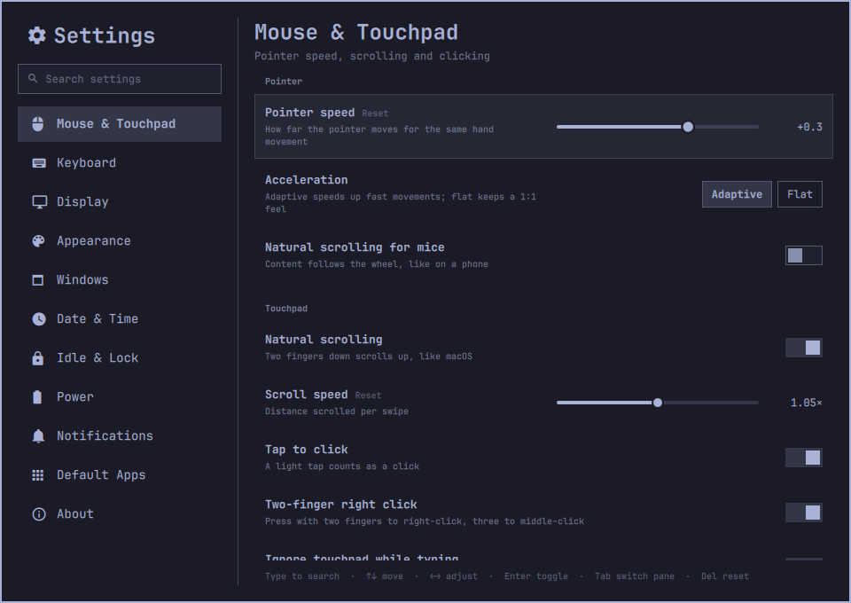
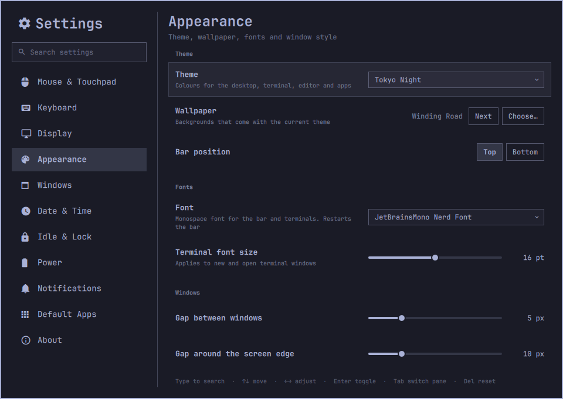
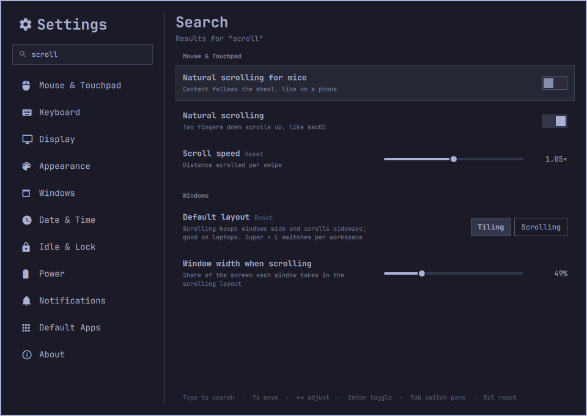

# Omarchy Settings

A native settings app for [Omarchy](https://omarchy.org), in the spirit of macOS System
Settings. Pointer speed, natural scrolling, key repeat, brightness, themes, fonts, window
layout, clock format, idle timers, power modes, default apps and more, all in one
searchable window. Changes apply instantly.



It's an Omarchy shell plugin, built from the same components as Omarchy's own clipboard
manager and bar panels, so it follows your theme, font and corner style. It opens
instantly and works entirely from the keyboard.

## Install

```bash
git clone https://github.com/charlesmccarthy/omarchy-settings ~/code/omarchy-settings
~/code/omarchy-settings/install.sh
```

Open it with **Super + I**, the gear icon in the bar, or **Settings** in the Omarchy menu.

## Pages

| Page | Settings |
|---|---|
| Mouse & Touchpad | Pointer speed, acceleration, natural scrolling (mouse and touchpad), scroll speed, tap to click, two-finger right click, ignore touchpad while typing, three-finger workspace swipe |
| Keyboard | Repeat delay and rate, keyboard layout, Caps Lock behaviour |
| Display | Brightness, scale, text size, scroll-to-zoom, night light |
| Appearance | Theme, wallpaper, bar position, font, terminal font size, gaps, borders, rounded corners, blur, animations |
| Windows | Tiling or scrolling layout, window width when scrolling, float new windows, focus follows mouse, resize by dragging edges |
| Date & Time | 12/24-hour clock, weekday, time zone, automatic time |
| Idle & Lock | Screen saver, screen saver and lock timers, stay awake, Suspend in the system menu |
| Power | Battery health, power mode when plugged in and on battery |
| Notifications | Do Not Disturb |
| Default Apps | Browser, terminal, editor, coding agent |
| About | Model, processor, memory, graphics, storage, Omarchy and kernel versions |

<p>
  
  
</p>

## Keyboard

| Key | Action |
|---|---|
| Type | Search all settings |
| ↑ ↓ | Move between settings (or pages, in the sidebar) |
| ← → | Adjust a slider or choice |
| Enter / Space | Toggle, or open a dropdown |
| Tab | Switch between the page list and the page |
| Delete | Reset a setting to your own config's value |
| Esc | Clear the search, then close |

## How it works

- Current values are read live from Hyprland (`hyprctl getoption`), so the app shows what
  is really in effect, including values from your own config files.
- Changes preview instantly with `hyprctl eval`.
- Only the settings you change in the app are saved, to one generated file:
  `~/.config/hypr/settings.lua`. Your hand-written `input.lua`, `looknfeel.lua` and the rest
  are never touched. `install.sh` adds a single line to `hyprland.lua` to load that file
  after your own config and before Omarchy's toggles.
- **Reset** removes a setting from `settings.lua`, so your own config's value applies again.
- Everything outside Hyprland (theme, fonts, brightness, power, idle, defaults, clock…) goes
  through `plugin/helper.sh`, which wraps Omarchy's own commands (`omarchy theme set`,
  `omarchy powerprofiles set`, `omarchy bar set`, …) so the app behaves exactly like the CLI.

## Uninstall

```bash
~/code/omarchy-settings/uninstall.sh          # keeps settings.lua
~/code/omarchy-settings/uninstall.sh --purge  # also deletes settings.lua
```

## Development

`./dev.sh` copies `plugin/` into `~/.config/omarchy/plugins/omarchy-settings/` on every save
and restarts the shell. Every setting is declared in `plugin/Schema.js`, so adding a new
one is usually a few lines; command-backed settings also get a case in `plugin/helper.sh`.

From the command line:

```bash
omarchy-shell shell call omarchy-settings get ""
omarchy-shell shell call omarchy-settings set "input.sensitivity=0.5"
omarchy-shell shell call omarchy-settings reset input.sensitivity
```

## Roadmap

Monitor resolution and arrangement for external displays, night light warmth, Wi-Fi and
Bluetooth shortcuts, and a macOS-style Alt+Tab switcher (as a separate plugin).

## License

MIT
