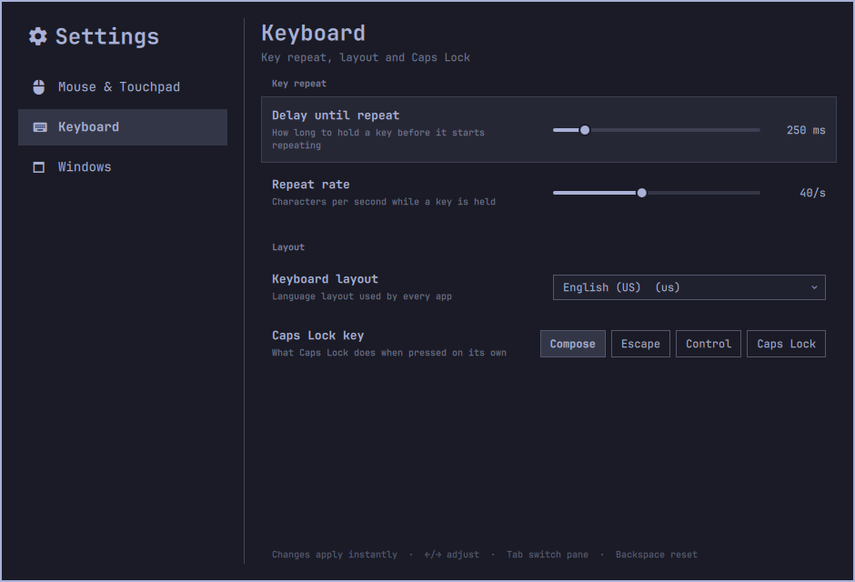
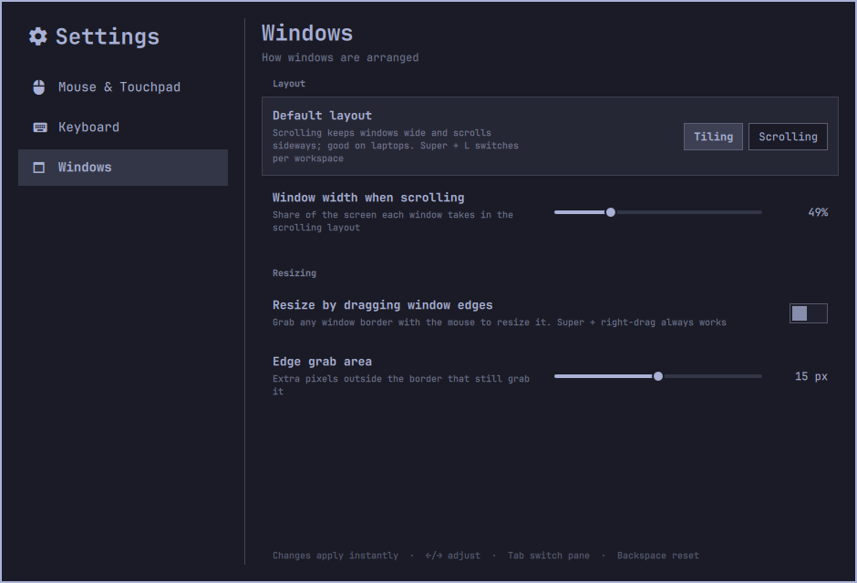

# Omarchy Settings

A native settings app for [Omarchy](https://omarchy.org). It covers the everyday settings
that normally mean editing Lua files: pointer speed, natural scrolling, tap to click, key
repeat, keyboard layout, window layout and more. Changes apply instantly.


It's an Omarchy shell plugin, built from the same components as Omarchy's own clipboard
manager and bar panels, so it follows your theme, font and corner style. It opens
instantly and works entirely from the keyboard.

## Install

```bash
git clone https://github.com/charlesmccarthy/omarchy-settings ~/code/omarchy-settings
~/code/omarchy-settings/install.sh
```

Open it with **Super + I**, the gear icon in the bar, or **Settings** in the Omarchy menu.

## Pages

| Page | Settings |
|---|---|
| Mouse & Touchpad | Pointer speed, acceleration, natural scrolling (mouse and touchpad), scroll speed, tap to click, two-finger right click, ignore touchpad while typing, three-finger workspace swipe |
| Keyboard | Repeat delay and rate, keyboard layout, Caps Lock behaviour |
| Windows | Default layout (tiling or scrolling), window width when scrolling, resize by dragging edges |

<p>
  
  
</p>

## Keyboard

| Key | Action |
|---|---|
| ↑ ↓ / j k | Move between settings |
| ← → / h l | Adjust a slider or choice |
| Enter / Space | Toggle or open |
| Tab | Switch between the page list and the page |
| 1–9 | Jump to a page |
| Backspace | Reset the setting to your config's value |
| Esc | Close |

## How it works

- Current values are read live from Hyprland (`hyprctl getoption`), so the app shows what
  is really in effect, including values from your own config files.
- Changes preview instantly with `hyprctl eval`.
- Only the settings you change in the app are saved, to one generated file:
  `~/.config/hypr/settings.lua`. Your hand-written `input.lua`, `looknfeel.lua` and the rest
  are never touched. `install.sh` adds a single line to `hyprland.lua` to load that file
  after your own config and before Omarchy's toggles.
- **Reset** removes a setting from `settings.lua`, so your own config's value applies again.

## Uninstall

```bash
~/code/omarchy-settings/uninstall.sh          # keeps settings.lua
~/code/omarchy-settings/uninstall.sh --purge  # also deletes settings.lua
```

## Development

`./dev.sh` copies `plugin/` into `~/.config/omarchy/plugins/omarchy-settings/` on every save
and restarts the shell. Every setting is declared in `plugin/Schema.js`, so adding a new
one is usually a few lines.

From the command line:

```bash
omarchy-shell shell call omarchy-settings get ""
omarchy-shell shell call omarchy-settings set "input.sensitivity=0.5"
omarchy-shell shell call omarchy-settings reset input.sensitivity
```

## Roadmap

Display (scale, resolution, night light, text size), Appearance (theme, background, font,
gaps, borders), Date & Time, Idle & Lock, floating windows by default, and search across all
settings.

## License

MIT
